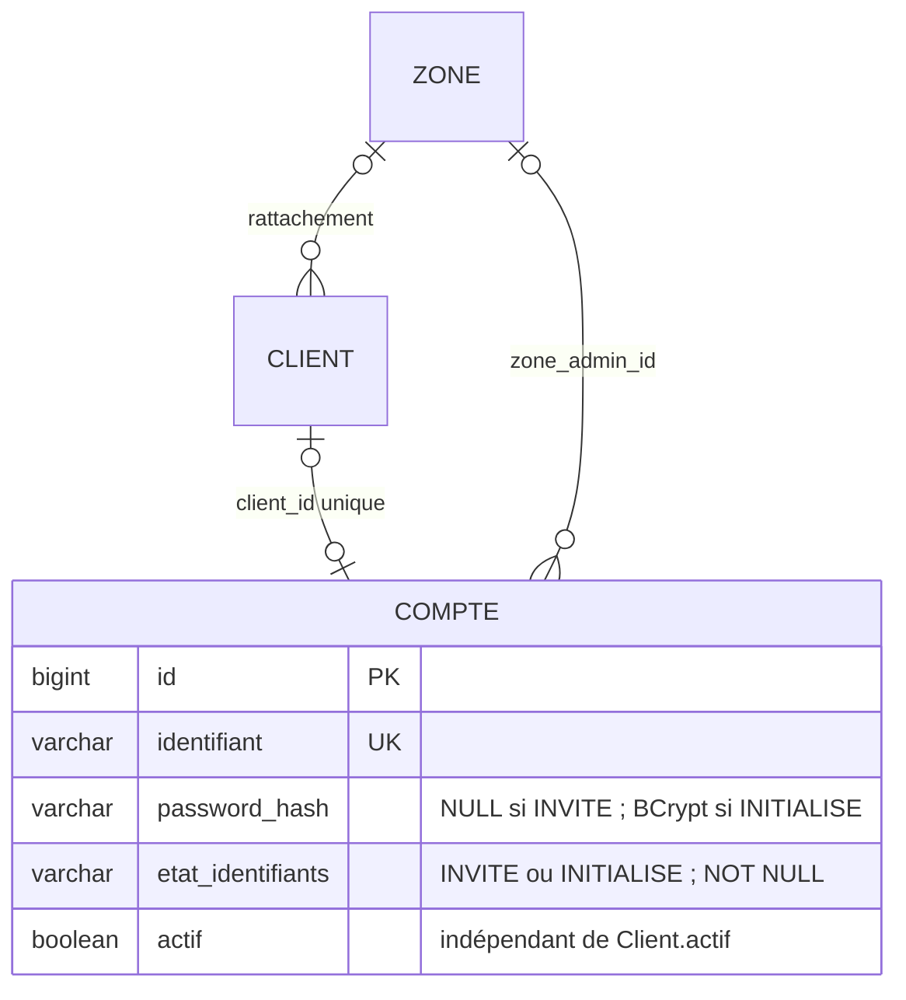
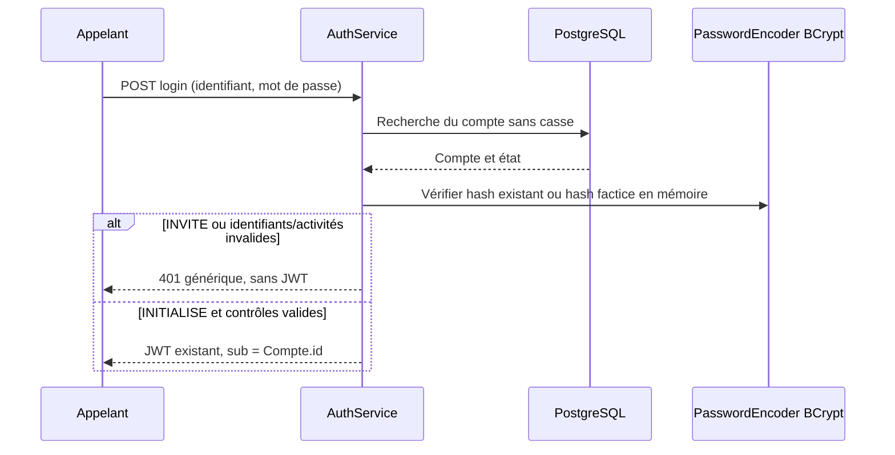

# Lot 3C.1 — socle des comptes invités

Issue [#19](https://github.com/Zoom225/Gestion-covoiturage/issues/19), base master 9c0a605 (PR #18 fusionnée).
Date : 24 octobre 2026. [Décisions](decisions.md), [contrats](contrats-api.md), [tests](tests-acceptation.md).

## Décision et périmètre

DEC-COMPTES-004 est validée par le responsable pour ce lot : un compte possède un état explicite
d'initialisation des identifiants, indépendant de Compte.actif et de Client.actif.
Cette précision complète A7/A8 et résout uniquement la représentation d'un invité en P06.
DEC-COMPTES-001 (inscription publique avec mot de passe choisi), DEC-COMPTES-002 (jeu fictif isolé)
et DEC-COMPTES-003 (e-mail ADMIN / matricule CLIENT, identité technique stable) restent inchangées.

| État | password_hash en PostgreSQL | Accès |
|---|---|---|
| INVITE | NULL uniquement ; aucun mot de passe initial ou hash de secours persistant | Login et JWT refusés, quelles que soient les activités |
| INITIALISE | Hash BCrypt non NULL, format de 60 caractères et coût pris en charge 04–31 | Possible seulement si Compte.actif et, pour CLIENT, Client.actif ; contrôles JWT et permissions conservés |

INITIALISE signifie que le mot de passe est établi. Ce n'est ni une preuve de vérification d'e-mail
ni une permission administrative. Une future inscription publique avec mot de passe déjà choisi
et haché ne devra pas détourner INVITE pour représenter l'attente d'e-mail : cette attente reste
une précondition d'accès séparée, dont le parcours n'est pas livré ici. Un compte INITIALISE inactif reste bloqué.
Les comptes préexistants sont conservés INITIALISES sans exigence rétroactive d'invitation/e-mail.
Le constructeur historique conserve ce comportement ; la fabrique Compte.invite prépare un objet
avec hash NULL, sans accès réseau ni insertion automatique. Aucun service de création n'est livré.

Hors lot : consommation d'invitation, jetons et empreintes, e-mails, invitations expirées/renvois,
inscription publique, création administrative, premier GLOBAL, changement/réinitialisation de mot de passe,
transitions de catégorie, changement de statut et Angular. Aucun compte fictif n'est créé.
La durée des invitations, la politique minimale du mot de passe, la vérification d'e-mail,
la livraison transactionnelle et le dernier GLOBAL restent à spécifier avant leurs lots respectifs.

## Modèle relationnel et migration V5

[Migration V5](../../src/main/resources/db/migration/V5__account_credential_state.sql) :

- ajoute compte.etat_identifiants VARCHAR(10) NOT NULL DEFAULT 'INITIALISE' ;
- rend password_hash nullable, sans modifier V2 ;
- impose par CHECK les deux couples état/hash et rejette un état inconnu ;
- vérifie avant modification que les hashes existants ont un format et un coût BCrypt compatibles ;
  en cas d'incompatibilité, arrêt transactionnel avec message générique, sans réécriture ni valeur sensible ;
- conserve IDs, identifiants, hashes existants, relations, activités, séquences et réservations V/C/O ;
- ne crée aucun compte et ne modifie pas Client.

Le défaut INITIALISE garde compatibles les insertions existantes qui fournissent déjà un hash.
Il ne permet pas un compte sans hash : la contrainte le refuse. Toute future initialisation devra changer
l'état et le hash dans une même transaction ; elle ne devra pas activer implicitement le compte ou le client.
Les coûts élevés permis par le format BCrypt ne constituent pas une politique de coût : les nouvelles
valeurs restent produites par le PasswordEncoder déjà configuré, jamais choisies via une requête HTTP.

Les contraintes CLIENT/ADMIN, GLOBAL/LOCAL et la cohérence login/matricule de V2/V4 restent actives.
V1–V4 sont immuables. V5 est validée uniquement sur PostgreSQL Testcontainers dans ce lot ;
elle n'est pas appliquée à la base locale de développement. Un lancement ultérieur du backend récent
contre cette base déclenchera normalement Flyway : faire d'abord l'audit et la sauvegarde habituels.

## Architecture et sécurité

Controller → Service → Repository → PostgreSQL reste inchangé.
Compte porte l'état et le prédicat partagé isAccesEffectif :
INITIALISE ET Compte.actif ET (pas de Client OU Client.actif).
AuthService.login conserve le travail BCrypt contre un hash factice interne en mémoire pour un compte
inconnu ou sans hash. Ce hash, déjà utilisé pour l'anti-énumération, n'est jamais affecté à un compte
et ne constitue pas un mot de passe d'invitation. Le refus reste un 401 générique sans révéler
l'existence ou l'état du compte.

Le convertisseur JWT appelle toujours AuthService.resolvePrincipal et relit PostgreSQL :
un sub valide pointant vers INVITE ne donne aucun principal, donc 401.
Le sujet JWT reste Compte.id. Aucun rôle ni catégorie n'est accepté depuis Angular.

AdminAuthorization, CompteService et les Specifications restent la source unique de périmètre.
GLOBAL lit tous les comptes, y compris invités ; LOCAL seulement les comptes CLIENT de sa zone,
y compris invités. Sans-zone et ADMIN sont toujours invisibles à LOCAL ; même 404 pour absent/invisible.
Les requêtes de périmètre précèdent pagination et count ; aucune nouvelle jointure ni recherche
secondaire n'est ajoutée par l'état scalaire. Les tests N+1 du lot 3B restent exécutés.

Une fuite de diagnostic a été détectée pendant les tests négatifs préexistants : les détails
de lignes rejetées transmis par PostgreSQL pouvaient inclure un hash dans les journaux Hibernate.
Le réglage commun spring.datasource.hikari.data-source-properties.logServerErrorDetail=false
supprime ces détails côté pilote JDBC sans masquer le code SQLState ni désactiver les tests.
Voir la [documentation officielle pgJDBC](https://jdbc.postgresql.org/documentation/use/#connection-parameters).
Un test capture les journaux et vérifie aussi l'exception complète sans afficher le hash.
Ce réglage porte sur les diagnostics de l'application ; il ne remplace pas la politique des journaux
du serveur PostgreSQL, qui reste une responsabilité d'exploitation distincte.

## Contrats HTTP

Aucun nouvel endpoint ni nouveau filtre. Login et me gardent leurs DTO.
Le DTO administratif ajoute seulement etatIdentifiants, enum INVITE/INITIALISE non sensible.
compteActif et clientActif sont inchangés ; accesEffectif inclut désormais INITIALISE.
L'état de la cible est consultable uniquement dans le périmètre administratif existant.
Les erreurs 400/401/403/404, le format ApiErrorResponse et no-store restent conservés.

## Tests et preuve d'exécution

La classe [InvitedAccountIntegrationTests](../../src/test/java/com/plateforme/covoiturage/InvitedAccountIntegrationTests.java)
utilise PostgreSQL 16.6 Testcontainers, serveur HTTP sur port aléatoire et clés JWT de test éphémères.
Les fixtures, INSERT/UPDATE de contrainte et migrations de schémas isolés touchent exclusivement ce conteneur jetable.

Couverture ajoutée : cinq profils invités, login et JWT refusés, quatre combinaisons d'activité,
huit couples état/hash invalides, défaut de compatibilité, constructeur initialisé et JWT,
rollback d'une transaction incohérente, changement atomique état/hash sans activation,
relecture de JWT, DTO et périmètre GLOBAL/LOCAL, migration V4→V5 avec cinq profils préexistants,
V1→V5 et références conservées, refus d'un ancien hash au coût incompatible sans fuite ni réécriture,
et absence du hash dans l'exception et les journaux applicatifs d'une violation de contrainte JPA.

| Vérification locale, 24 octobre 2026 | Résultat constaté |
|---|---|
| Java | 21.0.9 |
| Tests ciblés finaux | 26 tests, 0 échec, 0 erreur, 0 ignoré |
| mvnw.cmd clean verify final | BUILD SUCCESS ; 121 tests, 0 échec, 0 erreur, 0 ignoré ; 2 min 35 s |
| Composition du total | 95 tests antérieurs conservés + 26 tests du lot 3C.1 |
| Livraison Maven | JAR Spring Boot produit |
| Journaux Maven après correction JDBC | 0 hash BCrypt détecté ; capture d'exception/journaux négative testée |
| Base locale, contrôle en lecture seule | Flyway toujours V4 ; aucun compte créé ; volume PostgreSQL existant conservé |
| Fichiers locaux | Sept worktrees antérieurs, HEAD/état Git et contenus privés/modifiés comparés : inchangés |

Les messages de refus de migration des scénarios négatifs sont attendus et leurs rollbacks sont
vérifiés ; ils ne correspondent pas à un échec du build. La CI est vérifiée séparément sur la PR,
après publication : ce tableau décrit l'exécution locale réelle.
Les 95 tests antérieurs restent actifs ; seules les assertions de version Flyway courante et de
liste exhaustive des champs du DTO sont adaptées. Les 38 AC01–AC38 documentaires ne sont pas un
nombre de tests exécutés et ne prouvent pas les futurs parcours d'invitation.

## RM et AA : portée partielle

| Référence | Contribution du lot | Limite |
|---|---|---|
| RM01–RM03, RM13 | Refus INVITE, relecture JWT, activités indépendantes | Aucun nouveau droit métier ni workflow d'activation |
| RM49, RM51, RM57 | Lecture administrative des invités dans le périmètre existant | Aucun droit de création ou mutation ajouté |
| RM58–RM60 | CHECK, conservation, transactions de test, non-divulgation | Pas d'audit métier de nouvelles mutations puisque non livrées |
| RM04–RM12, RM14–RM48, RM50, RM52–RM56, RM59 | Règles, matricules et historique inchangés | Pas de nouvelles fonctions trajets/réservations/paiements |
| AA1–AA2 | Besoin et décision d'initialisation tracés | Invitation complète encore à valider |
| AA3–AA4 | Modèle relationnel et migration additive testés | Modèle du réseau incomplet |
| AA5 | Domaine, service, repository et mapper réutilisés | Aucun nouveau service de création |
| AA6 | BCrypt/JWT, refus de comptes non initialisés, DTO sans secret | Jetons et livraison hors lot |
| AA7 | Extension du seul DTO de consultation existant | Pas de nouveau REST d'invitation |
| AA8 | Contrat utilisable par Angular | Aucun frontend réalisé |
| AA9 | Erreurs contrôlées et cohérence des états | Politique de mot de passe à préciser pour les futurs formulaires |
| AA10 | Tests PostgreSQL/HTTP et CI de PR | Concurrence des jetons à tester dans un futur lot |
| AA11 | Décision, modèle, sécurité et preuves documentés | Soutenance complète encore à préparer |

Ces contributions ne valident aucun acquis dans son ensemble.

## Suite par petits lots

1. Valider durée et cycle de vie, empreintes des jetons, consommation unique et concurrence ;
   décider l'articulation avec vérification d'e-mail et activités.
2. Implémenter ces preuves dans une nouvelle migration et un composant dédié à leur responsabilité,
   avec verrouillage/consommation atomique et tests PostgreSQL.
3. Valider puis réaliser livraison d'e-mails et reprise après commit, anti-abus et renvoi.
4. Après décisions de création/périmètre et premier GLOBAL, intégrer les parcours administratifs
   sans dupliquer AuthService/CompteService.
5. Traiter séparément inscription publique et Angular.

La PR de ce lot exige validation avant fusion. Aucun de ces futurs lots n'est activé automatiquement.
