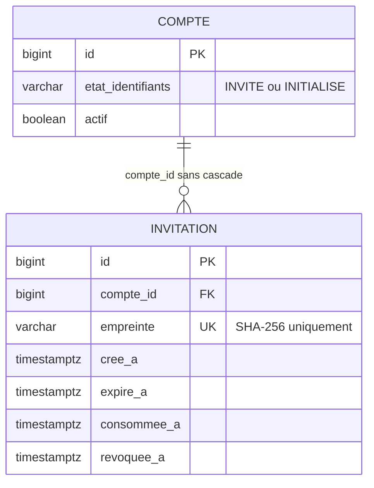
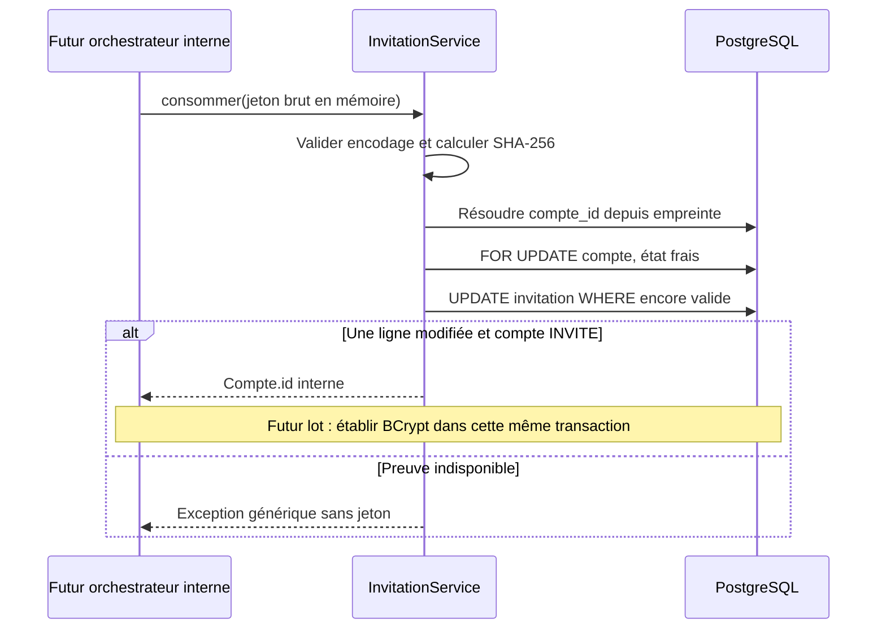

# Lot 3C.2 — persistance et gestion des invitations sécurisées

Issue [#21](https://github.com/Zoom225/Gestion-covoiturage/issues/21).
Base origin/master dba2dbc, PR #20 fusionnée ; [décisions](decisions.md), [acceptation](tests-acceptation.md).

## Périmètre et règles livrées

DEC-COMPTES-005 complète DEC-COMPTES-004 et A7 : jetons opaques générés par SecureRandom,
32 octets (256 bits), encodés en Base64 URL sans remplissage, soit 43 caractères.
L'empreinte stockée est le SHA-256 des 32 octets décodés, représenté par 64 caractères hexadécimaux minuscules.
Une saisie non canonique est refusée ; aucun alias d'encodage ne désigne une seconde preuve.

Le jeton brut est retourné une seule fois par le service interne, dans InvitationEmise.
Ce type n'est pas un DTO REST : son champ jeton est ignoré par Jackson et son toString est expurgé.
Aucun jeton brut en table, dans les DTO administratifs, OpenAPI, exceptions ou journaux.
L'empreinte n'est pas un JWT ; l'unique authentification JWT/BCrypt existante reste inchangée.

Seul un compte INVITE peut recevoir ou consommer une invitation. Aucun mot de passe n'est créé.
La consommation porte **uniquement sur la preuve** dans ce lot : elle ne change ni l'état
INVITE/INITIALISE ni les activités Compte/Client. Le compte reste donc sans accès après cette
opération interne isolée. Le futur service d'acceptation devra consommer la preuve et initialiser
le hash BCrypt dans **la même transaction englobante**, sans réactivation implicite.
Les tests de rollback prouvent que la preuve reste utilisable si cette transaction échoue.

Les activités ne constituent pas ici un droit de connexion : un invité actif ou inactif reste bloqué.
La gestion technique de sa preuve ne réactive rien. Les conditions du futur parcours utilisateur
lorsqu'un compte est désactivé devront être précisées avant son endpoint.

Aucun SMTP, endpoint d'invitation/acceptation/création, premier GLOBAL, inscription publique,
compte de démonstration ou Angular. Les politiques d'autorisation administrative de création et
de renvoi ne sont pas inventées : ce composant interne n'est pas une nouvelle frontière HTTP.

## Durée, expiration, révocation et renouvellement

Configuration : driveconnect.security.invitation.ttl, alimentée par INVITATION_TTL (durée ISO-8601).
Le profil dev seul propose PT24H. Son document est désactivé si prod est actif, même avec dev.
Hors dev, la durée reste absente tant qu'elle n'est pas configurée ; l'application peut démarrer
mais l'émission échoue avant toute insertion. Aucune durée de production n'est choisie implicitement.
Une durée nulle/négative est refusée ; l'expiration doit rester strictement postérieure à la création
après arrondi à la microseconde PostgreSQL.

Le Clock existant est injecté ; aucune lecture de Instant.now dans la logique d'invitation.
La fenêtre est [cree_a, expire_a[ : à l'instant exact d'expiration la consommation est refusée.
Un recul de l'horloge avant la création ne rend pas la preuve utilisable.

- emettre : compte INVITE, aucun enregistrement encore ouvert ; sinon conflit.
- revoquer : invalide l'invitation ouverte, opération idempotente ; une preuve consommée reste consommée.
  La révocation est aussi possible pour un compte devenu INITIALISE afin d'invalider un reliquat.
- renouveler : compte INVITE ; révoque l'ancienne preuve ouverte et en génère une nouvelle dans
  la même transaction. Possible après expiration, ou sans preuve ouverte ; aucune réutilisation d'empreinte.
- consommer : preuve connue, non expirée, non révoquée, non consommée et compte toujours INVITE.

Une invitation expirée n'est pas supprimée et ne supprime ni compte, ni Client, ni matricule ou historique.
L'index d'unicité des invitations ouvertes inclut les preuves expirées non révoquées :
le renouvellement explicite les révoque avant de libérer ce créneau. Aucun index ne dépend de now().
L'historique des preuves consommées/révoquées est conservé ; aucune purge n'est introduite.

## Modèle PostgreSQL et V6

[Migration V6](../../src/main/resources/db/migration/V6__secure_invitations.sql), additive :

- invitation.id PK ; compte_id FK obligatoire sans cascade de suppression ;
- empreinte VARCHAR(64), NOT NULL, UNIQUE global, CHECK hexadécimal minuscule ;
- cree_a/expire_a TIMESTAMPTZ obligatoires, expire_a > cree_a ;
- consommee_a/revoquee_a facultatifs : consommation dans la fenêtre, révocation après création,
  interdiction d'être à la fois consommée et révoquée ;
- index UNIQUE partiel : au plus une preuve sans consommation ni révocation par compte ;
- index (compte_id, cree_a) pour le rattachement et l'historique.

V1–V5 sont inchangées. V6 ne contient ni INSERT de compte ni transformation de données existantes.
Les tests V5→V6 conservent comptes INITIALISE/INVITE, hashes, activités, références et réservations V/C/O.
Aucune migration V6 n'est appliquée à la base locale partagée par ce lot.

## Architecture et garanties concurrentes

InvitationService porte cette responsabilité distincte ; CompteRepository est réutilisé.
Un seul nouveau repository pour la table invitation, aucune duplication d'AuthService/TokenService,
de PasswordEncoder ou de politique de permissions.

Toutes les opérations utilisent une transaction REQUIRED. La requête de verrouillage
SELECT etat_identifiants FROM compte WHERE id = ? FOR UPDATE relit la valeur scalaire en base :
elle ne dépend pas d'une entité obsolète du contexte JPA et verrouille la ligne du compte sans jointure externe.
Émission, renouvellement, révocation et consommation se sérialisent donc sur la même ligne.

La consommation ajoute un UPDATE conditionnel atomique PostgreSQL (empreinte, états, fenêtre,
compte encore INVITE) et exige exactement une ligne modifiée. Elle ne repose pas sur un
read/check/save d'entité en mémoire. Deux transactions concurrentes ne peuvent pas consommer deux fois.
Les tests couvrent aussi une invitation ou un compte préchargés dans un contexte JPA avant un autre commit.

Les futures opérations exposées devront appliquer les droits existants via AdminAuthorization
et les décisions de création restant ouvertes, avant d'appeler le service interne.
Aucun rôle ni périmètre n'est fourni par le jeton d'invitation.

## Erreurs et contrats

Aucun nouveau contrat REST exposé. Les DTO administratifs et routes login/me restent identiques.
Les méthodes Java ci-dessus sont les seuls contrats nouveaux.

GlobalExceptionHandler et ApiErrorResponse sont réutilisés :
InvitationInvalideException produit 400 INVALID_INVITATION avec un message identique pour preuve
inconnue, mal formée, expirée, révoquée, consommée ou compte non invité ;
InvitationConflictException produit 409 INVITATION_CONFLICT pour une émission incompatible.
ResourceNotFoundException existante est réutilisée pour un compte inexistant dans les opérations internes
de gestion. Ces traductions sont testées en MockMvc autonome, sans ajouter de route à l'application.
Les tests existants conservent 401/403/404, l'authentification et le périmètre GLOBAL/LOCAL.

## Tests et résultats

[InvitationIntegrationTests](../../src/test/java/com/plateforme/covoiturage/InvitationIntegrationTests.java)
utilise PostgreSQL 16.6 Testcontainers et une horloge contrôlée injectée, sans attendre 24 h.
Le contrôle de 64 jetons prouve format, non-déterminisme observé, absence de doublon et stockage des seules
empreintes ; il ne prétend pas démontrer statistiquement l'imprévisibilité cryptographique, garantie par SecureRandom.
Les contraintes et transactions sont exercées contre PostgreSQL réel ; aucun test n'utilise la base locale.

Couverture : durée configurable, défaut dev 24 h, durée absente hors dev, expiration exacte et
horloge reculée, révocation idempotente, renouvellement, INVITE obligatoire, absence de réactivation,
trois courses concurrentes, contextes JPA préchargés, rollback d'émission/consommation/renouvellement,
FK/UNIQUE/CHECK, migration V5→V6, non-divulgation et absence de nouvel endpoint/OpenAPI.
[InvitationExceptionHandlerTests](../../src/test/java/com/plateforme/covoiturage/InvitationExceptionHandlerTests.java)
vérifie les deux erreurs contrôlées.

| Validation locale du 24 octobre 2026 | Résultat réel |
|---|---|
| Java / PostgreSQL | Java 21.0.9 ; PostgreSQL 16.6 Testcontainers |
| mvnw.cmd clean verify | BUILD SUCCESS ; 169 tests, 0 échec, 0 erreur, 0 ignoré ; 4 min 16 s |
| Répartition | 121 tests antérieurs + 46 tests d'intégration invitation + 2 tests du handler |
| Migration / concurrence | V5→V6, contraintes, trois courses PostgreSQL et deux cas de contexte JPA préchargé réussis |
| Livraison | JAR Spring Boot produit |
| Fichiers et données locaux | Huit worktrees antérieurs, HEAD/états Git/fichiers privés inchangés ; PostgreSQL partagé toujours V4 et volume conservé |
| Contrôles documentaires | Liens relatifs valides ; 38 AC01–AC38 conservés ; aucun registre privé suivi ni secret local détecté |

La CI est contrôlée séparément après publication de la PR ; les résultats de cette table sont locaux.
 Les 121 tests antérieurs restent actifs ;
seule l'assertion de version Flyway courante est actualisée à V6. Les 38 AC01–AC38 sont documentaires,
avec des parcours encore futurs ; ils ne sont pas comptés comme tests applicatifs.

## RM et AA1–AA11 : contributions partielles

| Référence | Contribution | Limite |
|---|---|---|
| RM01–RM03/RM13 | Preuve distincte de JWT, INVITE obligatoire, aucune activité modifiée | Aucun accès utilisateur créé |
| RM49/RM51 | Droits administratifs existants conservés | Création/renvoi administratifs exposés non livrés |
| RM58–RM60 | Contraintes, empreintes, transactions/concurrence, historique sans jeton brut | Pas d'audit d'envoi puisqu'aucun envoi |
| Autres RM01–RM60 | Matricules, catégories, trajets, réservations et paiements inchangés | Aucune prétention d'implémentation de ces modules |
| AA1–AA2 | Besoin, règles et décisions de preuve tracés | Parcours d'acceptation complet à valider |
| AA3–AA4 | Relation Compte/Invitation, V6 et contraintes testées | Pas de transformation de la base locale |
| AA5 | Service spécifique, repositories et transactions | Pas d'orchestrateur de création |
| AA6 | Entropie, SHA-256, expiration, usage unique, absence de secrets | Livraison et anti-abus futurs |
| AA7 | Erreurs centralisées préparées, contrats Java internes | Aucun endpoint REST d'invitation livré |
| AA8 | Aucun impact Angular implémenté | Interface et liens utilisateurs futurs |
| AA9 | Validation du jeton et erreurs génériques | Politique utilisateur de mot de passe future |
| AA10 | PostgreSQL, courses/rollback, régression et CI de PR | Anti-abus et SMTP non testés |
| AA11 | Modèle, séquence, règles et preuves documentés | Soutenance complète non couverte par ce seul lot |

## Reste à valider et à développer

Durée de production, politique de mot de passe et du compte désactivé au futur parcours d'acceptation,
preuve d'e-mail versus invitation, droits de création/renvoi, anti-abus/limitation des tentatives,
SMTP et reprise transactionnelle, premier GLOBAL, endpoints d'acceptation puis Angular.
Aucun e-mail n'est réservé en outbox et aucune livraison n'est simulée comme effectuée.
La PR 3C.2 doit être validée avant fusion.
