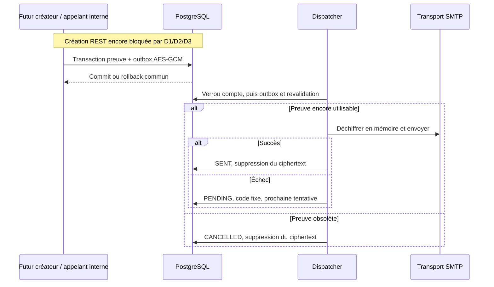

# Parcours de création et d'initialisation — issue #23

Base : origin/master 361286d, PR #22 fusionnée, issue #21 fermée.
**État : préparation partielle ; trois arbitrages fonctionnels bloquent la livraison REST complète.**
Aucun nouveau compte créé dans PostgreSQL partagé ; aucun envoi réel ni migration locale.

## Périmètre réellement implémenté

- AuthService.accepterInvitation : consommation de preuve et hash BCrypt dans une transaction REQUIRED.
  Vérification fraîche de Compte.actif et Client.actif avec verrouillage compte puis client ;
  mise à jour conditionnelle vers INITIALISE ; matricule, IDs et activités inchangés.
- Le compte INVITE inactif ou lié à un Client inactif est refusé ; la preuve reste non consommée
  après rollback. Deux acceptations concurrentes n'initialisent qu'une seule fois.
- Login/me, JWT sub=Compte.id et les rôles/périmètres existants restent conservés.
- Outbox transactionnelle chiffrée, transport SMTP optionnel, reprise et annulation des preuves obsolètes.
- Tests des cinq profils en mémoire applicative/PostgreSQL Testcontainers, sans SMTP externe.

**Non implémentés :** endpoint public d'acceptation, créations administratives REST,
création de Client/Compte depuis HTTP, bootstrap exécutable, inscription publique et Angular.
La méthode interne d'acceptation applique seulement les limites BCrypt déjà validées
(non vide, au plus 72 octets UTF-8). Elle n'est pas un endpoint public et ne remplace pas
la décision encore ouverte sur la politique minimale.

## Arbitrages fonctionnels nécessaires

La mission demande explicitement de ne pas inventer les permissions non décidées.
Les questions suivantes ont été soumises au responsable ; aucune option n'est présumée validée.

| Question | Source actuelle | Proposition soumise, non appliquée |
|---|---|---|
| D1 — création par LOCAL | Matrice : création LOCAL et OCCASIONNEL zoné À PRÉCISER ; P05/P07, habilitation non définie | Autoriser seulement les nouveaux clients LOCAL de sa zone, ou garder toute création au GLOBAL |
| D2 — activités initiales | P09 ne fixe pas Compte.actif/Client.actif des nouveaux comptes | Actifs à la création mais accès bloqué par INVITE ; accepter uniquement si toujours actifs ; alternative inactive exige un parcours de bascule explicite |
| D3 — politique minimale du mot de passe | P08 conserve BCrypt et 72 octets, pas de minimum défini | 15 caractères sans composition, ou 12 avec composition ; dans les deux cas 72 octets maximum |

Droits confirmés : GLOBAL peut créer les trois catégories et d'autres administrateurs ;
VIP reste réservé GLOBAL, LOCAL ne crée aucun administrateur et ne sort jamais de sa zone.
La connaissance du périmètre ne résout pas automatiquement le droit de création LOCAL.
Aucun compte préexistant n'est normalisé, activé ou soumis rétroactivement à une nouvelle politique.

## V7 — outbox chiffrée uniquement

[V7](../../src/main/resources/db/migration/V7__encrypted_invitation_outbox.sql) crée invitation_outbox.
V1–V6 restent inchangées ; aucun contact ou état supplémentaire n'est ajouté à Compte à ce stade.

- UUID PK, invitation_id FK UNIQUE sans cascade, référence explicite à la preuve V6.
- Payload AES-256-GCM : destinataire et jeton encodés en mémoire, jamais persistés en clair.
- Nonce de 12 octets aléatoires ; unicité (key_id, nonce), y compris après livraison.
  L'identifiant de clé doit toujours désigner la même clé ; ne pas réutiliser une clé sous un autre identifiant.
- Tag GCM de 128 bits ; AAD incluant message UUID, invitation.id et key_id contre la substitution de lignes.
- Clé externe obligatoire de 32 octets Base64, sans valeur de secours ni génération en production.
- États PENDING/SENT/CANCELLED ; contraintes de dates d'envoi, compteurs et cohérence du contenu.
- Le ciphertext est supprimé après livraison ou annulation ; nonce et métadonnées non secrètes restent
  pour l'unicité et le suivi. Une preuve consommée/révoquée/expirée ou un compte INITIALISE ne sont pas livrés.
- Les erreurs persistées sont des codes fixes, jamais les messages du fournisseur.

La clé n'est pas stockée dans la base. La base et la clé doivent être protégées séparément.
Conserver la clé tant qu'il reste des messages PENDING correspondants ; ce lot ne fournit pas de trousseau
multi-clés ni de rotation automatique. Rotation opératoire : suspendre les nouvelles émissions,
vider ou annuler l'ancienne file, puis remplacer clé et identifiant. Ne pas perdre une clé avec une file en attente.
Les données temporaires existent nécessairement en mémoire pour composer l'e-mail ; aucune
garantie d'effacement de toutes les copies String dans la JVM n'est revendiquée.

Références techniques : [GCMParameterSpec Java 21](https://docs.oracle.com/en/java/javase/21/docs/api/java.base/javax/crypto/spec/GCMParameterSpec.html)
et [envoi d'e-mails Spring Boot](https://docs.spring.io/spring-boot/reference/io/email.html).

## Transaction, reprise et garanties de livraison

InvitationDeliveryService.enqueue exige une transaction englobante : le futur créateur devra unir
Client, Compte, réservation du matricule, preuve et outbox dans ce même commit.
La création n'appellera pas SMTP. Les tests de rollback démontrent l'absence de preuve ou message fantôme.

Le dispatcher traite un message par transaction, dans l'ordre de verrou **compte puis outbox**.
La sélection de la ligne outbox utilise FOR UPDATE OF ... SKIP LOCKED et vérifie à nouveau son état. L'horloge est relue après l'attente du verrou compte pour refuser aussi une preuve expirée pendant cette attente.
Une erreur conserve le contenu chiffré et planifie une reprise (défaut technique configurable : 1 minute).
SMTP utilise STARTTLS obligatoire ou TLS explicite, validation d'identité du serveur et délais de 5 secondes.
Les messages/causes externes sont remplacés par une erreur générique. Le debug de session SMTP est désactivé.

Garantie : **au moins une livraison**, pas exactement une. Un serveur SMTP peut accepter un message
avant une panne précédant le commit SENT ; une reprise peut alors produire un doublon.
L'en-tête X-DriveConnect-Delivery-Id reste stable, mais n'oblige pas le destinataire à dédupliquer.
Le jeton demeure à usage unique. Aucun succès de livraison réelle n'est revendiqué par les tests simulés.

## Configuration et exploitation

Aucun secret n'est fourni dans le dépôt :

| Variable | Fonction |
|---|---|
| OUTBOX_KEY_ID | Identifiant non secret et stable de la clé AES |
| OUTBOX_ENCRYPTION_KEY | Base64 de 32 octets cryptographiquement aléatoires ; stockage externe persistant requis |
| INVITATION_DELIVERY_ENABLED | false par défaut ; activation explicite du worker |
| INVITATION_RETRY_DELAY | PT1M par défaut |
| INVITATION_ACCEPTANCE_URL | URL du futur écran d'acceptation : HTTPS ; HTTP localhost seulement sous dev sans prod |
| INVITATION_FROM | Expéditeur SMTP |
| SPRING_MAIL_HOST/PORT/USERNAME/PASSWORD | Configuration Spring Mail standard ; ne jamais publier le mot de passe |
| INVITATION_TTL | Durée de preuve existante ; PT24H sous dev seulement |

Le transport et le worker ne sont pas un parcours d'administration. Sans SMTP configuré, le backend
et les tests démarrent normalement ; aucun e-mail n'est envoyé automatiquement puisque le worker
est désactivé par défaut. Une tentative de livraison sans configuration reste en reprise.
L'enqueue sans clé valable échoue sans enregistrer de secret.

Le lien proposé utilise un fragment #invitation=... pour éviter un jeton dans les requêtes et access logs.
Le futur écran devra le retirer de l'adresse dès lecture et le transmettre au POST en JSON.
Ne pas configurer ce lien vers un écran inexistant : aucun frontend Angular n'est livré ici.
Les configurations de production doivent interdire les journaux de corps de requêtes et de dialogue SMTP.

## Contrats REST proposés, non exposés

- POST /api/auth/invitations/accept : jeton personnel et mot de passe, aucun compteId/rôle/catégorie ;
  204 sans JWT après commit, 400 générique si preuve indisponible, validation du mot de passe après D3.
- POST /api/admin/clients : contact, catégorie et zone autorisés ; matricule, rôle et état imposés ;
  GLOBAL confirmé, LOCAL selon D1 ; activités selon D2.
- POST /api/admin/administrateurs : GLOBAL uniquement ; périmètre/zone cohérents ; compte INVITE ;
  aucun mot de passe administratif fourni.
- Aucun endpoint public de bootstrap. Les GET administratifs et login/me existants restent inchangés.

Ces contrats ne sont pas annoncés comme opérationnels. Aucun stub HTTP ne simule une création ou une acceptation.

## Bootstrap GLOBAL — procédure cible à valider, non exécutable dans ce lot

1. Intervention opérateur ponctuelle, hors HTTP et dans un processus sans serveur web.
2. Configuration explicite de la base, TTL, destinataire opérateur et clé de livraison ; aucun identifiant
   ou mot de passe prédéfini ; aucune reprise des valeurs de démonstration.
3. Transaction sérialisée par un verrou PostgreSQL commun, puis vérification qu'aucun GLOBAL n'existe,
   y compris un GLOBAL INVITE/inactif ; second amorçage refusé.
4. Réutiliser le futur créateur pour Compte GLOBAL INVITE et outbox ; statut initial selon D2.
5. Le titulaire établit personnellement BCrypt par le futur parcours public après D3 ; aucune activation implicite.
6. Arrêter le processus opérateur ; conserver une trace sans secret. Tester deux amorçages concurrents.

Aucune commande factice ni initialiseur automatique n'est ajouté. L'implémentation opérateur reste à réaliser
après validation des règles de création ; aucun compte réel n'est créé par la mission.

## Tests réellement exécutés

| Vérification locale | Résultat réel du 24 octobre 2026 |
|---|---|
| mvnw.cmd clean verify | BUILD SUCCESS ; 224 tests, 0 échec, 0 erreur, 0 ignoré ; 4 min 22 s |
| Répartition | 169 tests antérieurs + 33 tests outbox/acceptation + 11 tests AES-GCM + 11 tests SMTP simulé |
| Livraison Maven | JAR Spring Boot produit |
| SMTP réel | Non exécuté ; transport simulé uniquement |
| Endpoints et créations HTTP nouveaux | Non implémentés, en attente de D1/D2/D3 |
| Bootstrap | Proposition documentaire uniquement ; aucun compte créé |

Les contrôles CI seront vérifiés séparément sur la PR de préparation ; ce tableau décrit les résultats locaux.

Les tests utilisent PostgreSQL 16.6 Testcontainers, une horloge contrôlée et un transport simulé :
aucun SMTP externe ni base locale de développement.

Couverture nouvelle : AES-GCM et AAD, nonce, rejet des altérations/mauvaises clés, expurgation,
outbox transactionnelle, reprise, annulation, double dispatch concurrent, contraintes V7,
préservation V6→V7, TLS/URL/erreurs SMTP simulés, acceptation interne des cinq profils, rollback et concurrence,
refus d'activité sans consommation, limites BCrypt existantes et connexion JWT normale après initialisation.

Les 169 tests antérieurs doivent rester actifs. Les 38 AC01–AC38 sont un référentiel documentaire,
pas 38 tests exécutés supplémentaires. Les nouvelles permissions, nouveaux DTO publics, bootstrap et
routes de création n'ont pas de résultat d'exécution puisqu'ils ne sont pas implémentés.

## AA1–AA11 et limites

| AA | Contribution partielle de cette préparation | Limite |
|---|---|---|
| AA1–AA2 | Parcours et ambiguïtés D1–D3 tracés | Décisions fonctionnelles non validées |
| AA3–AA4 | Outbox relationnelle, contraintes et V7 testées | Création Client/Compte et contact non livrés |
| AA5 | AuthService/InvitationService réutilisés ; livraison séparée par responsabilité | Orchestration de création future |
| AA6 | BCrypt/JWT, AES-GCM, absence de secret brut persistant, états et concurrence | Politique publique de mot de passe encore ouverte |
| AA7 | Contrats REST proposés, erreurs contrôlées préparées | Aucun nouvel endpoint livré |
| AA8 | Lien par fragment et besoin Angular documentés | Aucun frontend implémenté |
| AA9 | Contrôles internes et erreurs génériques | Validations publiques en attente de D3 |
| AA10 | Tests PostgreSQL, faux SMTP, courses, rollback, Git/CI | Pas de preuve d'envoi externe réel ni de bootstrap |
| AA11 | Modèle, séquence, sécurité, limites et preuves | Parcours TFE complet encore incomplet |

RM directement concernées : RM01–RM03/RM13, RM58–RM60 ; permissions RM49/RM51 conservées.
Aucune règle de trajets, réservation, capacité ou paiement n'est modifiée.
