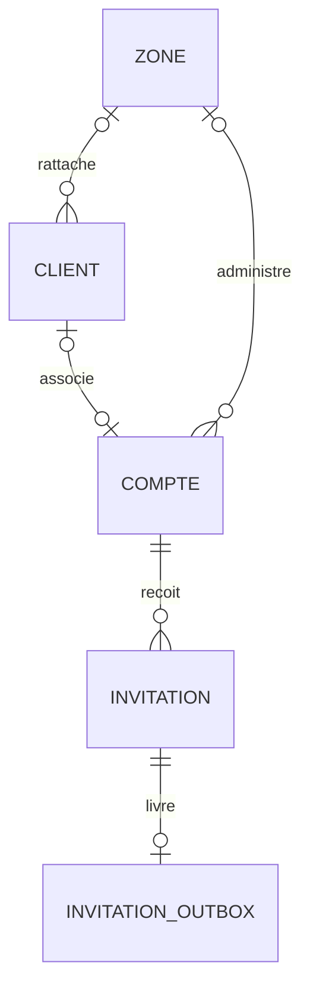
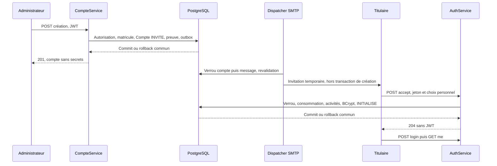
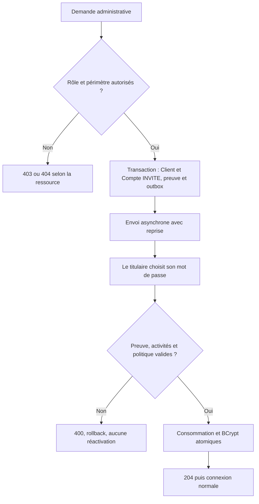

# Création administrative et activation par invitation — issue #23 / PR #24

Évolution du socle initial publié dans les commits edd93fc et 1ee1a4b. Le 24 octobre 2026,
le responsable a explicitement validé les quatre règles DEC-COMPTES-006 ; D1/D2/D3 sont résolus.
Les descriptions de préparation des lots antérieurs sont historiques.

## Périmètre livré et responsabilités

Controller (HTTP, DTO validés) → CompteService / AuthService → repositories → PostgreSQL.
AdminAuthorization centralise les droits ; CompteMapper produit le DTO administratif existant.
ClientNumberGenerator et InvitationService sont réutilisés. InvitationDeliveryService porte seulement
la livraison chiffrée ; aucun second service de comptes, JWT ou hachage n'est créé.

- GLOBAL crée VIP, LOCAL, OCCASIONNEL et les administrateurs.
- Tout LOCAL crée uniquement des clients LOCAL dans sa zone, sans habilitation supplémentaire.
  Il ne crée ni VIP, ni OCCASIONNEL, ni administrateur.
- Compte.actif=true et Client.actif=true à la création administrative. INVITE interdit login et JWT.
- Invitation acceptée : au moins 15 points de code Unicode, au plus 72 octets UTF-8, non blanc,
  aucune composition supplémentaire. Pas de normalisation/troncature du mot de passe.
- Aucun minimum rétroactif au login des comptes préexistants ; BCrypt et JWT sub=Compte.id conservés.
- L'acceptation ne réactive jamais Compte ou Client. Le matricule et les IDs restent inchangés.

## Contrats REST livrés

| Opération | Entrée | Succès | Autorisation |
|---|---|---|---|
| POST /api/admin/clients | email, categorie, zoneClientId facultatif sauf LOCAL | 201, CompteInvitationResponse, Location vers le compte | GLOBAL : trois catégories ; LOCAL : LOCAL dans sa zone |
| POST /api/admin/administrateurs | email, perimetreAdmin, zoneAdminId uniquement et obligatoirement pour LOCAL | 201, même enveloppe | GLOBAL uniquement |
| POST /api/admin/comptes/{id}/invitations | Aucun champ ; corps absent ou objet vide | 202, InvitationStatusResponse | Même droit que la création de la catégorie/profil cible, après visibilité SQL |
| POST /api/auth/invitations/accept | jeton, password uniquement | 204, aucun JWT | Public, preuve personnelle requise |

CompteInvitationResponse = compte (CompteAdministrationResponse existant) + invitationExpireA.
InvitationStatusResponse = statut PENDING + expireA. PENDING signifie « en file », pas « e-mail livré ».
Les champs inconnus sont refusés ; le serveur impose rôles, matricules, activités et INVITE.
L'e-mail ADMIN devient identifiant et destinataire, canonique en minuscules.
L'e-mail CLIENT est uniquement le contact de livraison, jamais le login, qui reste le matricule.
Les contacts ne sont pas exposés dans le DTO commun ; les e-mails ADMIN restent leurs identifiants autorisés.

400 : DTO/champs interdits, JSON invalide, profil incohérent, zone LOCAL manquante,
mot de passe hors limites ou preuve indisponible (invalide/expirée/révoquée/consommée/inactive).
401 : JWT absent/invalide/acteur désactivé sur route protégée.
403 : CLIENT, création interdite au LOCAL, ou zone de création hors périmètre.
404 : zone autorisée inexistante ; pour renvoi, même réponse pour compte absent/invisible.
409 : unicité, compte déjà INITIALISE, inactivité ou contact manquant lors d'un renvoi.
503 : configuration de chiffrement indisponible ; aucune création partielle.
Les erreurs n'incluent ni valeurs rejetées sensibles, ni détails SQL, ni trace technique.

## Transactions et concurrence

Création : réservation du matricule + Client + Compte INVITE + empreinte V6 + message V7,
dans une même transaction. Échec de la livraison en file = rollback de l'ensemble.
La séquence PostgreSQL peut avoir des trous ; aucun count()+1, aucune réattribution.
SMTP n'est jamais appelé pendant cette transaction.

Acceptation : InvitationService consomme la preuve avec le verrou compte et UPDATE conditionnel ;
AuthService conserve la transaction, verrouille/revérifie compte puis client, encode avec le seul
PasswordEncoder BCrypt, met INITIALISE et annule les messages PENDING. Tout refus annule la consommation.
Deux acceptations concurrentes ne réussissent qu'une fois.

Renvoi : sélection de la cible déjà filtrée par le périmètre SQL ; vérification de la catégorie autorisée,
verrou compte puis client, état INVITE et activités, contact enregistré. Annulation des anciens messages
et révocation de l'ancienne preuve, génération et mise en file de la nouvelle, dans une transaction.
Aucun destinataire libre ni changement de statut/catégorie n'est accepté par ce parcours.
Un compte ancien sans contact reste inchangé ; son renvoi produit 409 sans inventer d'adresse.

Le dispatcher conserve l'ordre compte → outbox et relit Clock après attente du verrou compte.
L'acceptation utilise compte → client → outbox. Les opérateurs concurrents sont testés sur PostgreSQL réel.

## Modèle relationnel et migrations

V1–V7 immuables. V8 ajoute uniquement compte.invitation_email nullable, longueur 254,
forme sans espaces et canonique en minuscules ; pas de backfill ni d'unicité du contact.
Les identifiants ADMIN restent limités à 100 caractères par le modèle existant.
Aucune règle sur plusieurs comptes partageant un contact n'est inventée.

INVITE implique hash NULL ; INITIALISE implique hash BCrypt conforme à V5.
V6 ne conserve que SHA-256 du jeton opaque SecureRandom 32 octets.
V7 conserve le destinataire et jeton temporaires sous AES-256-GCM, clé externe 32 octets,
nonce 12 octets UNIQUE(key_id,nonce), tag 128 bits, AAD message/invitation/key_id.
Le contenu chiffré est supprimé après livraison ou annulation ; nonce et métadonnées restent.



## Livraison, secrets et exploitation

Worker désactivé par défaut. Clé obligatoire via OUTBOX_ENCRYPTION_KEY (Base64 32 octets) et OUTBOX_KEY_ID,
jamais en Git ou en base. Garder la clé tant que des messages sont en attente ; vider/annuler la file
avant rotation. Un identifiant de clé représente toujours la même clé ; pas de trousseau automatique livré.
Le payload doit exister en mémoire pour l'envoi ; aucun effacement garanti de toutes les String JVM n'est annoncé.

Configuration explicite : INVITATION_DELIVERY_ENABLED, INVITATION_ACCEPTANCE_URL, INVITATION_FROM,
SPRING_MAIL_HOST/PORT/USERNAME/PASSWORD. Retry configurable INVITATION_RETRY_DELAY (PT1M par défaut).
INVITATION_TTL conserve PT24H sous dev seul ; une durée explicite est obligatoire hors dev.
SMTP : STARTTLS obligatoire ou TLS explicite, identité serveur vérifiée, timeouts de 5 secondes, debug désactivé.
Ne jamais activer les logs des corps HTTP/SMTP. Les erreurs de fournisseur sont remplacées par des codes fixes.

Garantie au moins une livraison, pas exactement une : crash après acceptation SMTP et avant commit
peut produire un doublon. L'en-tête de livraison reste stable ; la preuve demeure à usage unique.
Le lien utilise un fragment #invitation=... ; un futur écran Angular devra le retirer immédiatement
et soumettre jeton/password en JSON. Aucun écran Angular n'est livré ; l'URL doit viser un écran réel
avant d'activer les e-mails aux utilisateurs.

## Séquence et activité





## Premier GLOBAL : procédure opérateur, sans HTTP ni valeur par défaut

Le point d'entrée BootstrapGlobal n'est ni un bean runner ni un endpoint ; aucun amorçage au démarrage normal.
Opt-in DRIVECONNECT_BOOTSTRAP_ENABLED=true et BOOTSTRAP_ADMIN_EMAIL explicite obligatoires.
CompteService acquiert le verrou transactionnel PostgreSQL commun 2423001, partagé avec la création
administrative, puis refuse tout GLOBAL existant (actif, inactif, INVITE ou INITIALISE).
Le compte est créé INVITE et son invitation chiffrée en file dans le même commit.
Deux amorçages concurrents : un seul réussit. Aucun mot de passe choisi par l'opérateur.

Après validation des migrations pour la base cible et configuration explicite des secrets de livraison/JWT/base :

```powershell
# Dans un terminal opérateur dédié ; variables DB/JWT/outbox/TTL déjà chargées.
$env:DRIVECONNECT_BOOTSTRAP_ENABLED = "true"
$env:BOOTSTRAP_ADMIN_EMAIL = Read-Host "Adresse du premier administrateur GLOBAL"
try {
    java "-Dloader.main=com.plateforme.covoiturage.bootstrap.BootstrapGlobal" -cp ".\target\covoiturage-0.0.1-SNAPSHOT.jar" org.springframework.boot.loader.launch.PropertiesLauncher
    if ($LASTEXITCODE -ne 0) { throw "Amorçage refusé ou indisponible" }
} finally {
    Remove-Item Env:DRIVECONNECT_BOOTSTRAP_ENABLED -ErrorAction SilentlyContinue
    Remove-Item Env:BOOTSTRAP_ADMIN_EMAIL -ErrorAction SilentlyContinue
}
```

Ce processus force l'absence de serveur HTTP et désactive le worker ; le backend configuré livrera
ensuite la file. Le titulaire utilise le parcours normal d'invitation. Aucun secret ni compte par défaut.
Cette commande est documentée, pas exécutée sur la base locale partagée pendant la mission.

## Preuves de validation

Les 224 tests antérieurs sont conservés ; les nouvelles classes AccountWorkflowHttpIntegrationTests
et BootstrapContextIntegrationTests ajoutent preuves HTTP, PostgreSQL, concurrence, migration et contexte sans HTTP.
Le 24 octobre 2026 : `mvnw.cmd --batch-mode --no-transfer-progress clean verify` →
**BUILD SUCCESS ; 294 tests, 0 échec, 0 erreur, 0 ignoré ; 6 min 20 s**.
224 tests antérieurs conservés + 69 nouveaux cas HTTP + 1 contexte opérateur sans HTTP.
JAR Spring Boot produit ; son launcher opérateur refuse l'exécution sans opt-in avant tout démarrage Spring.
Deux attentes historiques sont adaptées : version Flyway courante V8 et présence des routes
désormais autorisées, avec contrôle renforcé de non-exposition du schéma InvitationEmise et jeton writeOnly.
Aucun test désactivé. Les preuves CI sont vérifiées séparément dans la PR #24.
Les 38 AC01–AC38 restent un référentiel documentaire, pas un total de tests JUnit supplémentaires.
SMTP externe non exécuté ; les transports des tests sont simulés, sans service externe.
Aucune V8 appliquée au PostgreSQL partagé et aucun compte réel créé pendant la mission.

## AA1–AA11 : contribution partielle, pas validation globale

| AA | Preuve de ce lot | Limite |
|---|---|---|
| AA1 | Parcours de création/acceptation, activité et séquence | TFE complet non couvert |
| AA2 | DEC-COMPTES-006 et résolution ciblée P05/P07/P08/P09 | Transitions, statuts et autres règles restent distincts |
| AA3 | Contact V8, relations et contraintes V1–V7 préservées | Pas de CRUD des zones/trajets |
| AA4 | Transactions et courses PostgreSQL réelles | Pas de validation complète de toutes les RM |
| AA5 | Services, mapper, politique et générateur réutilisés | Aucun service redondant |
| AA6 | BCrypt, JWT, absence de secrets dans DTO, outbox chiffrée | Anti-abus avancé et exploitation réelle restent à traiter |
| AA7 | Quatre POST et Swagger, 400/401/403/404/409/503 | Inscription publique et autres API hors lot |
| AA8 | Contrat de lien d'invitation pour Angular | Aucun frontend livré |
| AA9 | DTO stricts, politique UTF-8, retours génériques | UX Angular future |
| AA10 | Tests Testcontainers/HTTP/concurrence, clean verify et CI | Pas de preuve de livraison SMTP réelle |
| AA11 | Décisions, modèles, diagrammes, tests et historique PR #24 | Soutenance globale reste à préparer |

RM concernées : RM01–RM04, RM07/RM09–RM13, RM49/RM51, RM58–RM60.
Aucune règle de trajets, réservations ou paiements n'est modifiée.

Restent hors lot : transitions de catégorie, modification de statuts, inscription publique et preuve e-mail
distincte, anti-abus/rate limiting, durée d'exploitation hors dev, Angular. Ces sujets ne sont pas
présentés comme livrés ou comme obligations rétroactives sur les comptes existants.
