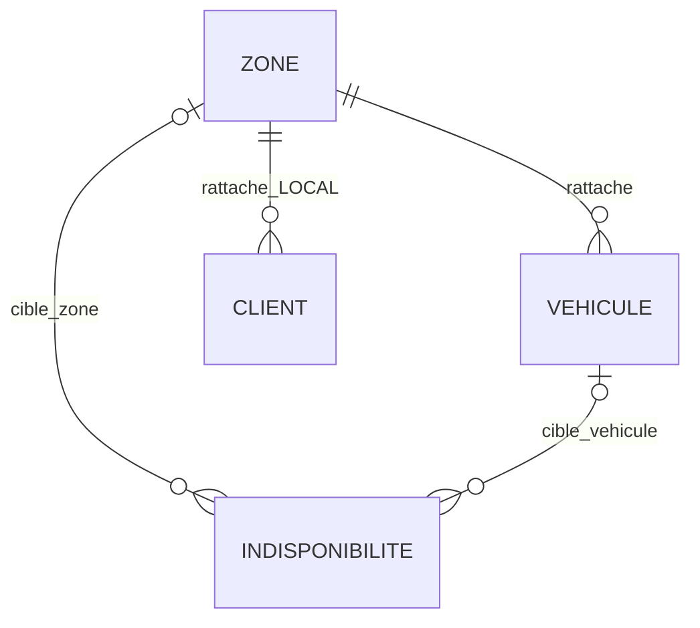

> Historique du socle initial. D1-D5 sont maintenant valides : voir [decisions-metier-d1-d5.md](decisions-metier-d1-d5.md). Les limites et resultats ci-dessous decrivent le commit 586cef0 ; le contrat courant figure dans ce nouveau registre.

# Lot 4 — consultation des référentiels et socle des indisponibilités

Issue [#25](https://github.com/Zoom225/Gestion-covoiturage/issues/25) ;
branche feature/zones-vehicles-unavailability, créée depuis origin/master 653e9a0.
Les issues #26/#27 et leurs worktrees ne sont pas modifiés par cette livraison.

## État réellement livré

Six GET administratifs : liste paginée et détail pour zones, véhicules et périodes enregistrées.
GLOBAL consulte le réseau ; LOCAL les ressources de sa zone uniquement.
L'accès CLIENT aux routes administratives reste interdit, quelle que soit sa catégorie.
Aucune mutation de zone/véhicule/indisponibilité, aucun archivage logique, aucun transfert de zone
et aucun calcul de disponibilité pour les trajets n'est exposé.

Le modèle existant est conservé : Zone(id, nom), Vehicule(id, zone), Client LOCAL rattaché à une zone.
La création administrative de client avec zone est déjà livrée au lot précédent ; pas de doublon.
Aucune propriété CLIENT, immatriculation, chauffeur ou responsabilité véhicule supplémentaire n'est inventée.

## Les cinq propositions restent NON VALIDÉES

La mission du responsable du 25 octobre les présente expressément comme des propositions,
et ne vaut pas validation. Elles remplacent les propositions de préparation antérieures lorsqu'elles diffèrent :

1. GLOBAL gère les zones ; LOCAL consulte sa zone ; suppression logique des zones référencées.
2. Trajet avec départ/arrivée obligatoires, instants UTC et pause de quinze minutes.
3. VIP sur zones autorisées, LOCAL sa zone, OCCASIONNEL sur zones configurées accessibles.
4. Première place logique organisateur, CONFIRMEE après 20 euros validés ; règle commune au privé.
5. Contrôle J-1 à 00 h 15 Europe/Brussels, rattrapage et idempotence.

Aucun de ces comportements nouveaux n'est activé par ce socle.
La consultation administrative et le périmètre RM49/RM51 préexistent à ces propositions.
Les quinze minutes restent une exigence confirmée du cahier, à tester avec les trajets du lot 5 ;
aucun trajet n'est créé ici. La contradiction historique RM15/RM27/RM40 attend un arbitrage tracé.

Sources : énoncé externe ../Enonce_CarShare_Network.docx ;
cahier externe ../cahier des charge/FIN-DriveConnect_Cahier_des_charges_FINAL_25P_DIAGRAMMES_UML_EA.docx,
sections 7, 8 (RM01–RM60), 14, 16 et 25 ; P07 de [decisions.md](../gestion-comptes/decisions.md).
Les deux chemins Word sont relatifs à la racine du dépôt, hors Git.

## Contrats REST opérationnels

| Route GET | Résultat 200 | Filtrage |
|---|---|---|
| /api/admin/zones | ReferencePageResponse de ZoneResponse | GLOBAL réseau ; LOCAL sa zone |
| /api/admin/zones/{id} | ZoneResponse | Même périmètre, absent/invisible = 404 |
| /api/admin/vehicules | Page de VehiculeResponse | Périmètre et zoneId optionnel par intersection |
| /api/admin/vehicules/{id} | VehiculeResponse | Zone réelle du véhicule |
| /api/admin/indisponibilites | Page de IndisponibiliteResponse | Zone réelle, zoneId et vehiculeId par intersection |
| /api/admin/indisponibilites/{id} | IndisponibiliteResponse | Cible zone ou véhicule de la zone autorisée |

Pagination technique reprise du module comptes : page indexée à 0 ; size=20 par défaut,
de 1 à 100 ; tri ID croissant ; décalage limité à Integer.MAX_VALUE. Aucun tri/recherche libre ajouté.
Un filtre d'une autre zone ou une combinaison sans résultat retourne une page vide et total 0.
Les filtres ne changent pas le périmètre et aucune ligne n'est filtrée après pagination/comptage.

DTO :
- ZoneResponse : zoneId, nom.
- VehiculeResponse : vehiculeId, zoneId, zoneNom.
- IndisponibiliteResponse : indisponibiliteId, zoneId, vehiculeId, debut, fin.
  zoneId est la cible directe : null si la cible est un véhicule ; vehiculeId est null pour une zone.
- ReferencePageResponse : content, page, size, totalElements, totalPages.

Aucun compte, e-mail, mot de passe, hash, jeton, empreinte ou secret de livraison dans ces DTO.
Cache-Control: no-store sur les succès. 400 : pagination/identifiant/filtre invalide ;
401 : JWT absent/invalide ou acteur désactivé ; 403 : acteur non ADMIN ;
404 : détail absent ou invisible, même code et message génériques. ApiErrorResponse et
GlobalExceptionHandler existants sont réutilisés. Swagger décrit les six GET sans promettre de mutation.

## Architecture et requêtes

Controller → ReferentielService → ZoneRepository/VehiculeRepository/IndisponibiliteRepository → PostgreSQL.
ReferentielMapper convertit explicitement les seules données autorisées.
AdminAuthorization.requireZoneScope centralise le périmètre déjà utilisé par les comptes :
requireAccountReadZone délègue à la même règle ; aucun second mécanisme d'autorisation.

Les Specification imposent le périmètre en SQL avant sélection et COUNT.
Pour les périodes, la requête accepte la cible directe zone ou la zone du véhicule avec jointures LEFT :
un véhicule ou une cible NULL de l'autre type ne doit pas exclure une période autorisée.
Les EntityGraph chargent les relations des véhicules/périodes ; pas de requête par ligne.
Le service est transactionnel en lecture seule. La chaîne SecurityConfiguration n'est pas modifiée :
ces routes utilisent le préfixe administratif JWT existant.

## Migration additive V9

[V9](../../src/main/resources/db/migration/V9__unavailability_reference.sql) crée seulement indisponibilite :
- PK technique ;
- FK zone_id et vehicule_id, sans cascade de suppression ;
- exactement une cible non NULL ;
- debut et fin NOT NULL, CHECK debut < fin ;
- index partiels (zone_id, debut, fin) et (vehicule_id, debut, fin).

V1–V8 sont inchangées ; aucune donnée existante n'est modifiée ni peuplée.
Les timestamps avec fuseau suivent le type technique déjà employé pour les preuves d'invitation.
Cela ne décide ni le fuseau métier des trajets, ni leur durée, ni le calendrier J-1.
Aucune règle d'exclusion/agrégation de périodes qui se chevauchent n'est ajoutée prématurément.
Il n'existe pas de verdict de disponibilité ou de filtre temporel public dans cette livraison.
Les périodes sont créées uniquement par les fixtures dans PostgreSQL Testcontainers pendant les tests.
Aucune migration V9 n'est appliquée à la base locale partagée.

Les deux cibles d'indisponibilité sont exclusives ; le diagramme n'ajoute aucun propriétaire CLIENT
au véhicule. La suppression logique des zones reste une proposition, aucun flag actif/archivé ajouté.

## Tests

Classe nouvelle : [ReferentielIntegrationTests](../../src/test/java/com/plateforme/covoiturage/ReferentielIntegrationTests.java).
Les 294 tests précédents restent actifs ; seule l'attente de version Flyway courante passe de 8 à 9.

| Preuve | Cas |
|---|---|
| GET réseau et local | Listes, détails, périodes zone et véhicule, totaux filtrés avant page |
| Non-divulgation | 401/403/404 homogène, filtres hors zone vides, DTO minimaux |
| Validation | Paramètres invalides et dépassement de décalage → 400 |
| N+1 | Deux requêtes par page complète (sélection + total), sans chargement par ligne |
| PostgreSQL | Cible absente/double, FK, dates nulles/égales/inversées refusées |
| Intégrité | Une période référencée empêche la suppression physique de sa cible |
| Migration V8→V9 | IDs, comptes, hash, activités, zone du client/véhicule conservés ; table nouvelle vide |
| Swagger | Les trois collections et détails existent en GET, aucun verbe de mutation exposé |

Exécution locale du 25 octobre 2026 : `mvnw.cmd --batch-mode --no-transfer-progress clean verify` → **BUILD SUCCESS ; 334 tests, 0 échec, 0 erreur, 0 ignoré ; 4 min 46 s**. Les 294 tests précédents sont conservés, avec 40 cas de ReferentielIntegrationTests. Le lancement ciblé de ces 40 cas est également réussi (1 min 37 s). JAR Spring Boot produit. Les contrôles CI sont vérifiés séparément sur la PR ; aucun résultat SMTP, trajet, création/archivage ou paiement nouveau n'est revendiqué.
Les scénarios de création/archivage et les conflits avec trajets ne sont pas annoncés comme testés.

## RM et AA1–AA11

| Acquis | Contribution partielle réelle | Limite |
|---|---|---|
| AA1 | Inventaire et distinction propositions/confirmations | Lot 4 incomplet avant arbitrages |
| AA2 | Contrats de lecture, sources et RM tracés | Droits de mutation encore ouverts |
| AA3 | Modèle zone/véhicule/période, relations exclusives | Aucun modèle de trajets livré |
| AA4 | V9, FK/CHECK/index et reprise V8→V9 | Aucun changement de données partagées |
| AA5 | Couches, mapper, politique commune | Pas de services de mutation provisoires |
| AA6 | JWT et périmètre SQL réutilisés | Aucun nouveau rôle ou permission CLIENT |
| AA7 | Six GET et Swagger | Aucun POST/PATCH/DELETE de référentiel |
| AA8 | DTO préparés pour Angular | Aucun frontend développé |
| AA9 | Entrées et erreurs contrôlées | Validations de trajets futures |
| AA10 | PostgreSQL, HTTP, N+1, migration et CI | Résultats à consigner après exécution |
| AA11 | Modèle, contrat, preuves et limites | TFE complet non validé par ce seul lot |

RM01–RM03 : authentification/périmètre ; RM07 : rattachement LOCAL existant conservé ;
RM19/RM56 : socle des périodes uniquement, pas de disponibilité de trajet encore calculée ;
RM49/RM51 : lecture administrative ; RM58–RM60 : intégrité et absence de secrets dans les réponses.
Les autres RM, notamment trajets, capacité, paiements et dettes, restent hors développement dans ce lot.

## Enchaînement

Compléter le lot 4 après validation des mutations/archivage et contrats correspondants.
Ne pas démarrer le lot 5 sur un modèle de lot 4 non stabilisé.
Ne pas démarrer le lot 6 sur des contrats de réservation provisoires.
La PR de ce socle sera en brouillon, liée à #25 par Refs, sans fermeture prématurée ni fusion.
