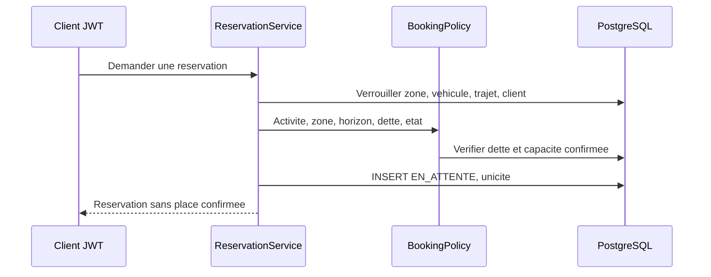

# Lot 5 — trajets et réservations EN_ATTENTE

Issue #26. PR dépendante de la branche du lot 4 ; aucune fusion automatique.
Les propositions de preparation.md sont historiques. D1–D5 sont désormais validées dans le [registre](../lot-4-zones-vehicules/decisions-metier-d1-d5.md).
La proposition « l'organisateur paie avant les autres » est écartée : D4 donne la priorité au premier paiement validé, sans place confirmée garantie à l'organisateur.

## Contrats REST

Tous ces endpoints exigent un CLIENT authentifié et actif. Identité issue du JWT et de PostgreSQL ; aucun organisateur envoyé par le frontend.

| Opération | Contrat |
|---|---|
| POST /api/trajets | zoneId, vehiculeId, depart/arrivee ISO-8601 avec décalage, type PUBLIC/PRIVE ; 201, organisateur déduit et sa réservation EN_ATTENTE créée atomiquement |
| GET /api/trajets | page 0, size 20/100, ID croissant, zoneId facultatif intersecté ; publics dans zones autorisées et privés dont on est participant, avant pagination et total |
| GET /api/trajets/{id} | Même 404 pour absent ou invisible |
| POST /api/trajets/{id}/reservations | Demande personnelle publique, sans clientId et sans confirmation |
| POST /api/trajets/{id}/participants | Organisateur d'un privé seulement, clientId cible soumis à toutes les règles métier ; 201 EN_ATTENTE |
| GET /api/reservations/me | Seulement ses réservations, mêmes conventions de pagination |

400 : entrée mal formée, dates égales/inversées ; 401 : JWT absent/invalide ou compte inactif ;
403 : rôle, zone ou propriété non autorisés ; 404 : ressource introuvable/invisible ;
409 : horizon, dette ACTIVE, doublon, indisponibilité, véhicule incompatible ou trajet fermé.

## Règles et concurrence

- ZoneAccessPolicy du lot 4 : VIP sur autorisation explicite, LOCAL dans sa zone, OCCASIONNEL sur ouverture explicite ; zone active et fuseau configuré.
- BookingPolicy centralise zone, activité client, dette réelle PostgreSQL et horizon.
- Ouverture inclusive à départ moins 30/10/3 jours dans le fuseau de la zone, en conservant l'heure locale y compris lors des changements d'heure ; départ strictement futur.
- Instants persistés timestamptz/Instant ; DTO UTC avec fuseau de zone pour l'affichage Angular futur.
- Création trajet + organisateur EN_ATTENTE dans la même transaction.
- Aucune réservation EN_ATTENTE ne réserve une capacité ; leur nombre peut dépasser quatre.
- Aucun mécanisme de paiement ni statut CONFIRMEE attribué par ces API.
- COMPLET/ANNULE refusent toute nouvelle réservation ; unicité trajet/client.
- Intervalle de véhicule contrôlé avec marge 15 minutes, égalité à 15 minutes permise.
- Indisponibilités de zone ou véhicule du lot 4 contrôlées à création et réservation.
- JourneyLocks impose zone → véhicule → trajet → client ; relecture après attente du verrou.
- Trigger PostgreSQL de calendrier sérialise aussi les écritures SQL directes par véhicule ; trigger de capacité et FK protègent les invariants SQL.
- Un client ayant une dette ACTIVE ne peut créer, réserver ni être ajouté. La dette conserve une référence réelle à son trajet et à son organisateur.

## Modèle V11

Zone 1—N Trajet ; Vehicule 1—N Trajet ; Client 1—N Trajet (organisateur).
Trajet 1—N Reservation ; Client 1—N Reservation ; UNIQUE(trajet, client).
Trajet 1—0..1 DetteTrajet, montant fixe 80, regle entre 0 et 80, état cohérent ACTIVE/REGULARISEE, sans expiration.
Le socle de dette est nécessaire au contrôle réel du lot 5 ; aucune API de règlement ni génération automatique avant le lot 6.
FK composite véhicule/zone et trajet/organisateur ; dates et états contraints ; index de recherche.
V1–V10 conservées ; aucune migration sur la base partagée.

## Limites fonctionnelles précises

RM46/RM47 et section 25 : délais d'annulation, réinscription et remboursements restent à préciser.
Modification d'un trajet déjà réservé et transition REALISE non définies : aucune mutation correspondante exposée.
Droits d'écriture véhicules/indisponibilités toujours ouverts au lot 4.
Ces opérations n'empêchent pas création, consultation, réservation et intégration du paiement validées.
Les réservations ne deviennent CONFIRMEE que dans le service de paiement du lot 6 ; aucun faux paiement de secours.

## RM et AA

RM05–RM08/RM12/RM14–RM28/RM33–RM40/RM44/RM56/RM58–RM60 : exigences suivies, confirmation réservée au lot 6.
AA1/AA2 : décisions et limites ; AA3/AA4 : modèle, contraintes et migration ; AA5 : couches et politiques communes ;
AA6 : JWT/propriété ; AA7 : API/Swagger ; AA9 : validations ; AA10 : tests PostgreSQL et concurrence ; AA11 : preuves.
AA8 Angular non développé. Contributions partielles, aucun acquis annoncé entièrement réalisé.
Résultats réels à renseigner après clean verify.

## Résultats exécutés

Validation finale locale du 25 octobre 2026 : `mvnw.cmd --batch-mode --no-transfer-progress clean verify` : **BUILD SUCCESS, 383 tests, 0 échec, 0 erreur, 0 ignoré ; 7 min 21 s**. 349 tests antérieurs et 34 nouveaux scénarios, PostgreSQL 16.6 Testcontainers. La première suite complète comptait 382 réussites ; un cas supplémentaire protège la portée exacte du blocage de dette. La fixture JourneyIntegrationSupport est réutilisée sans dupliquer les scénarios. V10→V11, concurrence de véhicules et doublons, zones, horizons avec changement d'heure, 400/401/403/404/409 et Swagger contrôlés. Aucun paiement, aucune modification de la base partagée.
