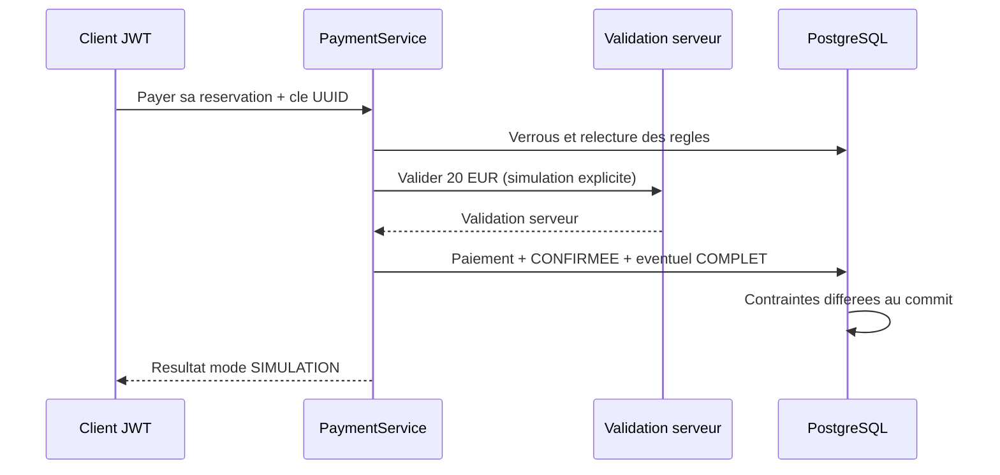
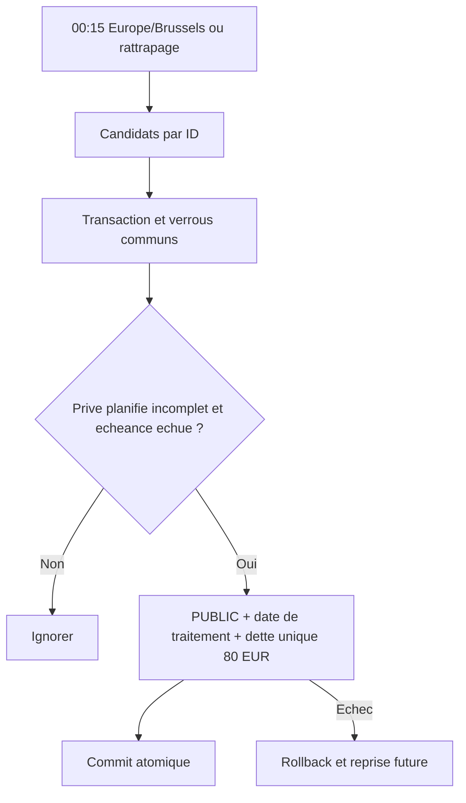

# Lot 6 — paiements simulés, dettes et J-1

Issue #27 ; dépend du contrat stabilisé du lot 5, lui-même dépendant du lot 4.
Les propositions du fichier preparation.md sont historiques ; D4 et D5 les remplacent.
La simulation est explicitement prévue par le cahier, section périmètre et parcours nominal. Aucun paiement bancaire réel n'est annoncé.

## Endpoints et sécurité

| Endpoint | Règle |
|---|---|
| POST /api/reservations/{id}/paiements | CLIENT propriétaire actif ; montant fixé à 20,00 EUR par le serveur ; Idempotency-Key UUID obligatoire ; réponse 200 contenant nature PLACE et mode SIMULATION |
| GET /api/dettes/me | CLIENT authentifié, seulement ses dettes ; pagination 0/20/100, ID croissant |
| POST /api/dettes/{id}/paiements | CLIENT propriétaire actif ; montant décimal strictement positif, au plus deux décimales, sans dépasser le restant dû ; Idempotency-Key UUID |

Les réponses n'exposent ni clé d'idempotence, ni mot de passe, hash, JWT, preuve d'invitation ou contenu d'outbox.
401 anonyme/inactif ; 403 rôle/zone ; 404 propriétaire absent/invisible ; 400 syntaxe/validation ;
409 état, capacité, dette, montant incompatible ou conflit de rejeu ; 503 validation de paiement indisponible.
Un booléen accepted/valide transmis par le navigateur n'est jamais une preuve.

## Paiement de place

1. Identifier le client en base depuis le JWT, contrôler la propriété de la réservation.
2. Verrouiller zone, véhicule, trajet puis client ; relire l'état après attente.
3. Retourner le résultat déjà enregistré pour un rejeu identique. Une autre clé sur une réservation payée est refusée.
4. Recontrôler activité, zone autorisée, horizon, dette, disponibilité, état PLANIFIE et moins de quatre CONFIRMEE.
5. Demander la validation au PaymentGateway serveur.
6. Enregistrer 20 EUR et confirmer dans la même transaction ; quatrième confirmation → COMPLET.
7. PostgreSQL contrôle au commit l'équivalence paiement enregistré / réservation CONFIRMEE.

L'organisateur reste EN_ATTENTE tant qu'il n'a pas payé. Un participant peut payer avant lui ; aucune place confirmée ne lui est réservée par priorité d'inscription. Même règle pour les participants privés.
Le verrou du trajet protège le premier paiement validé et la dernière place ; aucune validation retenue sans attribution.

ConfiguredPaymentGateway ne simule qu'avec dev actif, prod absent ET driveconnect.payments.simulation-enabled=true.
dev+prod est refusé. En dehors de ce mode, réponse 503 ; aucun prestataire inventé.
Une intégration bancaire future devra traiter autorisation/capture, webhooks, idempotence et compensation externe ; la transaction actuelle ne prétend pas englober un prestataire distant.

## Dettes et règlements

DetteTrajet du lot 5 est conservée : montant fixe 80 EUR, UNIQUE(trajet), organisateur vérifié par FK composite.
PaiementDette et PaiementPlace sont séparés, avec montants décimaux, UUID uniques et horodatage UTC.
Les tentatives refusées ne deviennent jamais des paiements persistés ; le modèle conserve les validations finales.
Les clés sont uniques par nature de paiement ; une même clé ne peut être réaffectée à une autre ressource de cette nature.

Règlement partiel : ACTIVE ; somme 80 EUR : REGULARISEE ; dépassement refusé. Aucun délai d'expiration.
Le verrou client puis dette sérialise les règlements et les contrôles de dette associés aux réservations.
Une contrainte différée rapproche le cumul des règlements du montant regle.
La régularisation supprime seulement le blocage de dette ; elle ne réactive jamais Compte ou Client.

## J-1 : D5

Cron quotidien 0 15 0 * * *, zone Europe/Brussels ; activation configurable par driveconnect.scheduling.j1.enabled.
L'échéance d'un trajet est 00:15 Europe/Brussels la veille de sa date de départ exprimée dans ce fuseau de traitement.
Les trajets PRIVE/PLANIFIE dont l'échéance est échue sont rattrapés, y compris après une interruption prolongée.
Le traitement relit l'état courant sous verrou ; quatre confirmés, PUBLIC, COMPLET ou ANNULE sont exclus.

Chaque candidat utilise une transaction indépendante : conversion PUBLIC, horodatage traite_j1_le et dette 80 EUR atomiques.
Le verrou commun avec les paiements, la relecture et l'unicité SQL empêchent double dette ou dépassement de capacité.
Une panne sur un candidat annule cette conversion et produit uniquement un avertissement fixe avec son ID ; les autres candidats continuent. Le candidat sera repris au prochain passage.
Un curseur sur les IDs évite les omissions liées au changement de type pendant une pagination.

## V12

- Ajout nullable de l'horodatage J-1, cohérent avec PUBLIC.
- Tables paiement_place et paiement_dette, FK, CHECK, UNIQUE et index.
- Contraintes différées paiement/confirmation et cumul/règlements.
- Aucun changement V1–V11 ni conversion de données existantes.
- Précontrôle bloquant si V11 contient déjà des CONFIRMEE sans preuve ou des dettes réglées sans historique : plan de rapprochement explicite requis, aucun paiement inventé.
- Migration testée seulement dans PostgreSQL Testcontainers, jamais appliquée à la base partagée.

## Preuves et limites TFE

Les contrats d'annulation, remboursement, réinscription et REALISE restent hors implémentation tant que non définis.
Les droits d'écriture des véhicules/indisponibilités demeurent ouverts au lot 4.
Aucune donnée fictive initialisée au démarrage, aucun compte réel ou e-mail créé.

RM25–RM45, RM48/RM50–RM55 et RM58–RM60 ; correction RM15/RM27/RM40 tracée dans D4.
AA1/AA2 : décisions et analyse ; AA3/AA4 : modèle et intégrité ; AA5 : responsabilités ;
AA6 : permissions ; AA7 : API ; AA9 : erreurs ; AA10 : concurrence/Testcontainers/CI ; AA11 : preuves.
AA8 Angular futur ; contributions partielles, aucune validation complète des AA revendiquée.
Résultats exécutés à consigner après clean verify.

Modèle : Reservation 1—0..1 PaiementPlace ; DetteTrajet 1—N PaiementDette ; Trajet 1—0..1 DetteTrajet.

## Preparation du parcours client integre

GET /api/zones et GET /api/vehicules fournissent au CLIENT actif les seules zones D3 autorisees et leur flotte. Le filtre zoneId est intersecte ; SQL avant pagination et total, conventions 0/20/100. Service/DTO/mapper de referentiels reutilises, aucun droit d'ecriture ajoute. Ces lectures permettent le choix zone/vehicule avant POST /api/trajets sans utiliser les API administratives.

## Résultats réellement exécutés — 25 octobre 2026

- Validation ciblée initiale : deux échecs réels (syntaxe du test de panne et HTTP 400 d'une clé absente), corrigés sans désactiver de scénario.
- Paiements/J-1 ciblés après correction : 33 tests, aucun échec/erreur/ignoré.
- Première suite complète du cœur : 421 tests, aucun échec/erreur/ignoré, BUILD SUCCESS en 10 min 45 s.
- **Livraison finale intégrée : `mvnw.cmd --batch-mode --no-transfer-progress clean verify` → BUILD SUCCESS ; 425 tests, 0 échec, 0 erreur, 0 ignoré ; 7 min 44 s. JAR Spring Boot produit.**
- Les 383 tests du lot 5 sont conservés ; 37 cas PaymentIntegrationTests et 5 cas SimulationGatewayTests s'ajoutent.
- PostgreSQL 16.6 Testcontainers et HTTP réels : dernière place, rejeux, refus/rollback, J-1 à l'instant limite, rattrapage, concurrence J-1/paiement, dette unique, règlements concurrents, solde partiel/complet, FK/CHECK/preuves différées et migration V11→V12.
- Le test de migration refuse explicitement des CONFIRMEE historiques sans preuve, conserve ces lignes puis migre le scénario EN_ATTENTE approuvé ; aucune conversion silencieuse.
- Le mode simulé est refusé en prod, dev+prod, hors dev et lorsque désactivé.
- Catalogue CLIENT : zones/catégories, SQL avant total, filtre par intersection, désactivation, refus de mutation et 401/403.
- JWT, BCrypt, invitations chiffrées et Swagger non régressés ; liens internes et absence de fichiers privés suivis contrôlés.
- Aucune V12 appliquée à la base partagée : lecture seule confirme V4 ; volume driveconnect-dev_postgres-data conservé, PostgreSQL healthy.

| AA | Preuve livrée | Limite |
|---|---|---|
| AA1–AA2 | Règles D1–D5, lecture du cahier, RM et limites explicites | Mutations non définies isolées |
| AA3–AA4 | Modèle relationnel et V12 avec contraintes testées | EA complet à maintenir dans le dossier TFE |
| AA5 | Services, politiques, repositories, DTO et mappers | Aucun second mécanisme d'authentification |
| AA6 | JWT, propriété, scopes et prod exclu de la simulation | Aucun prestataire bancaire réel |
| AA7 | Paiement, dette, catalogue client et Swagger | Annulations/remboursements non spécifiés |
| AA8 | Contrats préparant Angular | Frontend non développé |
| AA9 | 400/401/403/404/409/503 et rollback | Pas de saisie Angular |
| AA10 | 425 tests locaux, Git et CI vérifiée séparément | Résultat CI à consulter sur le commit publié |
| AA11 | Contrats, séquence, activité, preuves et PR | Contribution partielle au TFE |

## Ordre d'intégration Git proposé

1. Revoir la PR #28 du lot 4 vers master ; aucune fusion par cette mission.
2. Après sa fusion autorisée, actualiser les références, intégrer le master actualisé dans la branche du lot 5 en préservant les fichiers locaux, puis recibler #29 vers master et revérifier la CI.
3. Après fusion autorisée du lot 5, faire de même pour la PR du lot 6 actuellement basée sur feature/trips-reservations.
Les worktrees sont conservés. Ne pas réinitialiser une branche ni forcer un push pour simplifier cette chaîne.
