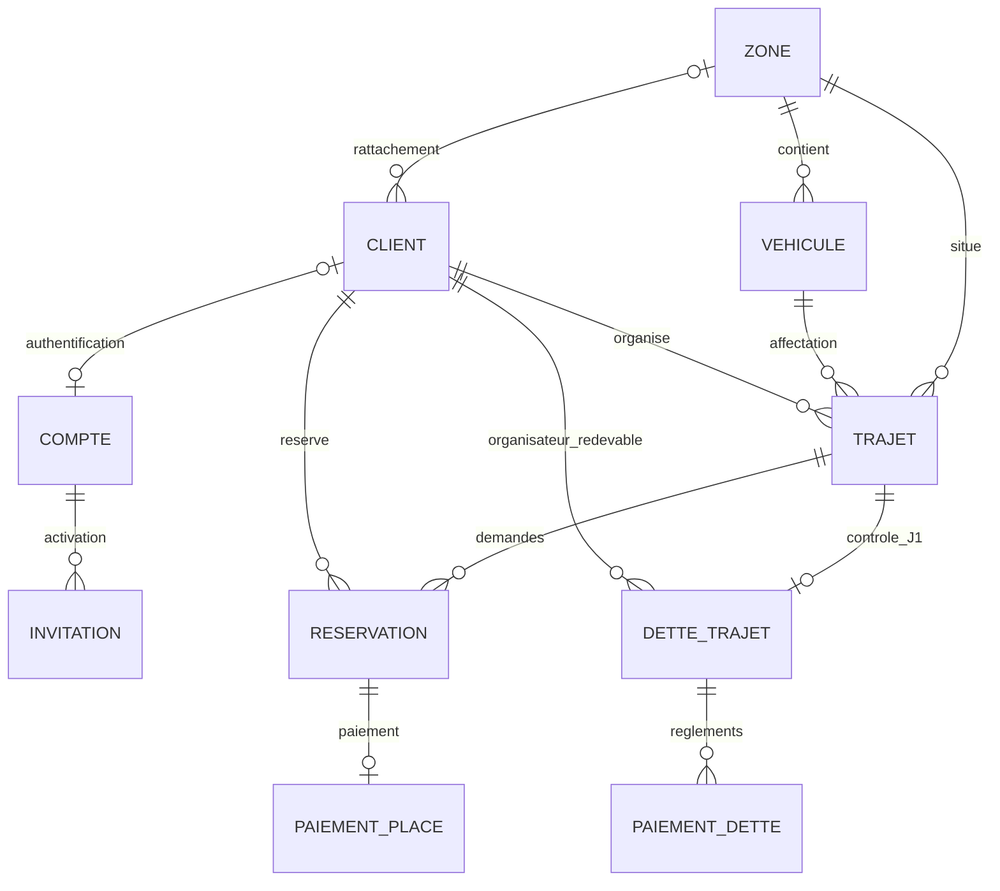

# Demonstration du TFE Gestion-covoiturage

Ce document utilise la liste pedagogique AA1 a AA11 fournie dans la conversation.
Il ne remplace pas la grille officielle du professeur et ne certifie aucun acquis.

## Parcours livrables a montrer

1. Se connecter avec un compte actif fourni par le parcours d'invitation.
2. Ouvrir les trajets accessibles ; filtrer par zone et parcourir les pages.
3. Consulter un trajet public et demander une reservation personnelle.
4. Dans Mes reservations, payer 20 EUR en simulation et observer CONFIRMEE.
5. Annuler avant le depart puis consulter le paiement et son remboursement
   eventuel : remboursement integral a H-24 ou avant uniquement sans penalite active
   a l'annulation. Une annulation avec penalite n'ouvre aucun remboursement retroactif.
6. Creer un trajet : zone, vehicule, lieux, horaires et type. Le chauffeur est
   fourni par la flotte ; l'organisateur occupe une des quatre places passagers.
7. Sur son trajet prive, ajouter un participant par son identifiant client ;
   celui-ci paie sa propre reservation depuis son compte.
8. Consulter ses dettes et regler un montant partiel puis le solde restant.
9. Avec un compte administrateur, consulter les comptes de son perimetre,
   creer un client et renouveler une invitation. Aucun mot de passe ni jeton
   d'invitation n'est affiche par l'administration.

Les dates saisies utilisent le fuseau de l'appareil, indique dans le formulaire.
Elles sont envoyees en UTC ; le detail et la liste affichent le fuseau du trajet.
Les controles definitifs restent dans le backend : les boutons et guards Angular
orientent l'utilisateur et ne remplacent pas une autorisation.

## Tracabilite des acquis

| Acquis | Preuve presente | Travail de presentation restant |
| --- | --- | --- |
| AA1 | Acteurs CLIENT/ADMIN, categories et perimetres dans les decisions et la matrice de permissions | Relier les besoins aux demandes validees du client |
| AA2 | Regles, limites et contrats dans les dossiers de lots et l'architecture | Consolider le cahier des charges final |
| AA3 | Entites Java, migrations et diagramme ci-dessous | Expliquer la transformation en modele relationnel |
| AA4 | FK, CHECK, contraintes et verrous ; tests PostgreSQL de concurrence | Montrer le refus de la cinquieme place passager |
| AA5 | controller, service, service/impl, repository, entity, dto et mapper | Suivre un appel de reservation dans le code |
| AA6 | Spring Security, JWT, controles de propriete et de zone | Montrer un refus 401/403 et la separation CLIENT/ADMIN |
| AA7 | API existantes raccordees par CovoiturageApi | Expliquer la validation et les transactions |
| AA8 | Pages de trajets, reservations, paiements/dettes et comptes administratifs | Faire une demonstration avec des comptes de recette |
| AA9 | GlobalExceptionHandler, messages metier et formulaires Angular | Montrer une erreur de capacite ou de dette active |
| AA10 | Tests Java/PostgreSQL, tests Angular, navigateur et workflows CI | Presenter les derniers rapports ; distinguer mocks et API reelle |
| AA11 | Architecture, regles et ce guide de demonstration | Preparer l'oral et harmoniser le dossier final |

## Modele relationnel principal

Ce diagramme montre les relations principales. Les contraintes de migrations
restent la reference executable, notamment l'unicite de la reservation active
et l'appartenance de la dette a l'organisateur.

Le catalogue d'itineraires est independant : ses libelles peuvent aider la saisie,
sans devenir une contrainte geographique sur les trajets. Les autorisations VIP
et les indisponibilites completent le modele ; leurs contraintes sont presentees
dans les migrations et la documentation des referentiels.

## Ce qui a ete simplifie

- Une seule politique pour les autorisations de zone et l'eligibilite :
  ZoneAccessPolicy a ete fusionne dans BookingPolicy.
- JourneyLocks utilise des instructions explicites ; les deux vehicules sont
  verrouilles dans l'ordre des identifiants en cas de modification.
- Un seul service HTTP Angular pour les parcours metier ; la session reste dans
  AuthService et les messages communs dans api-error.util.
- Pagination commune et formulaires ordinaires ; aucun framework d'etats
  supplementaire, aucun bus d'evenements et aucune integration bancaire.

## Limites explicites

Les ecrans administratifs de zones, vehicules, indisponibilites et statistiques
ne sont pas encore raccordes dans Angular ; leurs API backend restent disponibles.
L'affectation nominative des chauffeurs n'est pas geree. Les paiements sont simules
uniquement lorsque le backend est configure pour cela en developpement.
L'annulation globale d'un trajet ne fait pas partie des parcours exposes.

Les tests navigateur utilisent des reponses HTTP controlees. Ils prouvent les
interactions, les requetes et l'affichage, pas une ecriture sur la base partagee.
Les regles et les ecritures reelles sont verifiees dans PostgreSQL Testcontainers.
Une recette complete navigateur vers Spring Boot avec des comptes de recette
reste a executer avant la defense.

## Verification locale du 9 novembre 2026

- Backend : 179 tests cibles reussis sur les autorisations, referentiels, paiements,
  verrous concurrents, politiques et modifications de trajets ; JAR genere.
- Angular : 46 tests reussis et verification TypeScript stricte avec detection
  des declarations inutilisees.
- Navigateur : 17 scenarios reussis, dont six nouveaux parcours metier. Apres
  le dernier controle d'identifiant de route, les six scenarios metier ont ete
  rejoues avec succes sur le build final.
- Build Angular de production reussi. Les scenarios couvrent notamment les
  horaires UTC, la conservation des secondes, la cle de reprise de paiement,
  l'annulation, les dettes, les comptes locaux et les erreurs metier.
- Controles automatises d'accessibilite et de debordement mobile reussis sur
  les pages testées ; ils ne remplacent pas un audit humain.

Le port 4200 etait deja occupe par une autre application pendant la recette.
Playwright demarre desormais exclusivement son propre serveur sur 4173.
Les rapports navigateur et les captures sont dans frontend/playwright-report
et frontend/test-results, exclus du versionnement.

La verification ulterieure de la [regle de penalite et remboursement](regles-annulation-penalites.md)
porte les resultats a 840 tests Java valides apres correction et rejeu du
controle V22, 47 tests Angular et 18 scenarios navigateur reussis.
